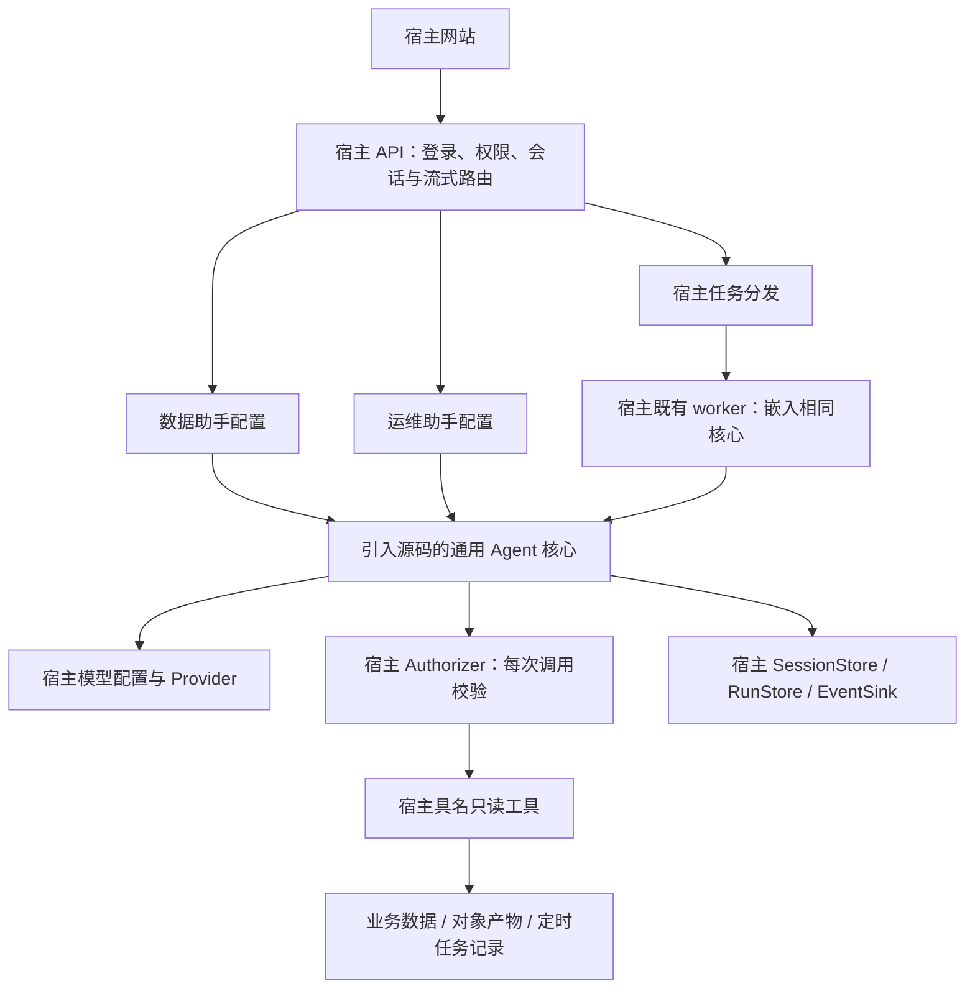

# RFC 001：可嵌入企业应用的 Agent 核心

状态：提案。日期：2026-10-12。项目名暂定 EasyAgent Server Core。

## 1. 定位与约束

在 GitHub 维护通用源码；宿主引入固定版本，在自己的 API/worker 进程中实例化助手。项目交付可嵌入核心及虚构示例，不交付必需独立部署的 Agent 平台。

核心负责有界模型/工具循环和协议。宿主负责登录、权限、实际数据、会话/任务存储、HTTP/SSE、调度和生产发布。业务特定的字段、规则、来源和配置不进入公开核心。

1. 工具显式注册，默认拒绝未知工具，每次调用重新鉴权。
2. 模型仅提出查询名称与业务参数，不能修改身份、工具集合、endpoint 或预算。
3. Chat/Agent 共用有界执行器，不迁入 Goal、Workflow、命令或生成代码执行。
4. 会话、任务、证据和公开事件提供宿主接口，不强制安装 PG/Redis 或某个 Web 框架。
5. 持久性、多 Pod 和崩溃恢复取决于宿主适配器履行合同，不能仅由进程内锁保证。
6. 库级封装限制模型能力，不宣称隔离共享进程被完全控制后的权限。

## 2. 嵌入架构



图中的组件是 Go 包和职责，不是必须拆出的服务。工具通过函数/接口调用，无强制 RPC、查询代理服务或新增 Agent Pod。API 处理即时问答；宿主可将长分析/排查交给既有 worker。两条路径使用同一权限与工具执行链。

拟议公开布局：

```text
core/model/            消息和 Provider 接口
core/tool/             schema、调用、Observation 协议
core/runner/           有界循环、预算、取消和重复查询守卫
core/agent/            Definition、依赖组装和执行入口
core/session/          上下文与公开历史合同
core/run/              步骤、检查点、执行权与恢复合同
core/event/            公开事件和模型预览协议
providers/openai/      固定配置的兼容 HTTP provider
examples/embedded/     宿主内嵌两个虚构助手，无独立服务要求
examples/host-adapters/ 内存示例及持久适配器参考
NOTICE.md              上游来源与本地改造映射
```

`core/` 只依赖 Go 标准库和内部协议，不反向依赖 provider、数据库、Redis、Web 框架或宿主应用。provider 与适配器按需要引入，宿主可以沿用既有 Router HTTP 实现。纯核心目录需要可按清单复制，禁止藏有对完整 SDK 或私有包的依赖。

## 3. AgentDefinition 与宿主依赖

Definition 保存 ID/版本、提示模板版本、工具名称/版本集合、模型策略、Chat/Agent 预算及输出规则。它由宿主在启动或受控配置流程中创建；用户不能上传定义、凭据或系统提示。

Dependencies 包含 Provider、Authorizer、ToolExecutor、SessionStore、RunStore 和 EventSink。权限适配器缺失时不提供生产执行；内存适配器仅用于 demo/单进程环境。恢复性存储未提供时明确不支持后台持久恢复，不能静默降级。

宿主在真实登录上下文构造 Principal：tenant、subject 和授权引用。单租户应用可由宿主配置固定 tenant；核心不要求引入额外企业 IAM。身份不来自模型、用户正文或工具返回值。

助手实例按会话/执行上下文绑定账户和范围；共享 Provider 连接可以，但不能共享可变模型历史。两类助手分别注册工具和会话目录。助手配置不是额外权限来源。

## 4. 工具与权限接口草案

```go
type Principal struct {
    TenantID  string
    SubjectID string
}

type ExecutionContext struct {
    Principal Principal
    RunID     string
    StepID    string
    Fence     uint64
}

type ToolCall struct {
    Name      string
    Version   string
    Arguments json.RawMessage
}

type Observation struct {
    EvidenceID string
    Status     string // available / missing / denied / unavailable / invalid
    Summary    string // 范围过滤与脱敏后的证据摘要
}

type Authorizer interface {
    CheckTool(context.Context, ExecutionContext, ToolCall) error
}

type ToolExecutor interface {
    Execute(context.Context, ExecutionContext, ToolCall) (Observation, error)
}
```

这是接口草案，尚非可导入包。ExecutionContext 由宿主和核心创建，模型只提出 ToolCall。完整权限接口还覆盖助手、会话、任务、历史与证据读取；每次执行前验证最新授权，失败默认拒绝。后台恢复从宿主可信存储重建账户，再重新取授权，不只回放旧权限快照。

工具定义包括严格输入 schema、版本、可信并发声明、超时与结果大小限制。参数校验仍需核对日期、资源归属、分页和范围。模型不能指定任意 SQL、URL、bucket、连接参数、subject 或 tenant。业务过滤条件与服务端授权取交集。

宿主只给查询工具注入必要的只读接口/凭据，不把全应用 DB 管理连接或服务容器传给核心。对象检查可提供受限元信息和小型清单读取；不顺带获取日志全文、ZIP 或员工对话。数据库/对象存储权限仍由真实后端执行。

ToolExecutor 为受信 Go 代码，不能上传、自动发现或动态加载。核心执行链固定为 schema 校验 → 预算与执行权校验 → Authorizer → Execute → 结果范围过滤与脱敏 → Evidence 登记。适配器回调不能通过模型参数跳过这条链。

证据 ID 由宿主登记，模型只引用存在且当前获准的证据。403/404/超时/不合法产物分别报告；引用校验不能完全保证模型事实判断正确，结果需区分事实、推测与未核验项。

## 5. Chat / Agent 与执行预算

Chat 完成当前问题，允许少量只读查询。Agent 主动组合多步查询并保存分析/诊断结果，步骤是数据结构和事件，不是脚本或 Workflow DSL。

建议初始预算：Chat 90 秒/8 次模型请求/12 次工具调用，Agent 5 分钟/16 次模型请求/24 次工具调用。正式值由宿主结合现有时限和负载验证；宿主可以收紧，用户和模型不能扩大。并发默认串行，只有可信适配器声明安全才允许最多 2 路并发。

同时限定响应字节、工具超时、输入/输出 token、重试及账户/tenant 并发。模型调用前预留预算；未知 token 用量或价格时不能承诺精确金额硬上限。预算耗尽明确终止，不把部分诊断变成成功。

Chat 与 Agent 的结果以宿主校验和成功提交为准。Agent 可要求有限必查项与证据，不用模型 Goal 评估器无限继续。诊断任务完成不表示生产问题已修复。

## 6. 会话、事件与宿主 HTTP

会话按账户、助手和数据权限边界隔离。模型私有历史与公开问题/最终答案分别处理；较窄权限不能继承旧的较宽工具证据。默认同一会话最多一个活跃执行；用户可新建其他会话。

EventSink 接收 turn、step.start/progress/end、delta、done 和 error，公开内容经过字段白名单，不包含原始工具参数/结果、模型推理、凭据或上游响应正文。

文本 delta 为临时预览，带 attempt/turn/generation 标识；最终答案在宿主事务提交后发布。后台事件持久化可提供递增 seq 和快照恢复；逐 token 重放不是首版承诺。

宿主沿用自己的路由和 UI：即时 Chat 可继续现有 POST + SSE，断线/取消合同由宿主明确；后台 Agent 通常提交后返回任务 ID，再订阅/查询进度和显式取消。核心不要求新建 `/v1` API、统一返回 202 或改变旧问答接口。

宿主保证对取消、会话切换和迟到事件的隔离。后台订阅断开只停止展示，不隐式创建/取消任务；取消排查不能取消被检查的生产任务。恢复、结果、分页与长订阅需核对当前授权。

## 7. 宿主持久状态与多 worker

SessionStore 保存会话与完整公开轮。RunStore 保存执行身份/Definition 版本、状态、预算、步骤、证据引用、幂等键、执行权和检查点；EventSink 可与 RunStore 同事务发布最终事件。

后台状态为 queued → running → succeeded / failed / cancelled / interrupted。取消先停止后续请求；明确取消不自动恢复。Definition/工具合同不兼容时 interrupted，禁止偷偷换版本重跑。

生产多 worker 由宿主 PG/Redis 或等价组件承担：Run 与分发意图原子接收，Redis 仅唤醒；幂等键、领取、期限租约和递增 fence 防重复提交。租约过期停止后续调用，最终提交验证当前执行权，旧 worker 无法覆盖新结果。

已完成步骤复用；未知请求保留已消耗/预留预算，重查按预算计数。飞行中的读取可能重叠，模型请求也不能保证端到端 exactly-once。不得宣称一个进程内锁解决跨 Pod 执行。

核心通过 RunStore 接口使用这些能力，不另建一套生产队列或任务调度服务。宿主需添加明确的 Agent 任务种类、容量与公平调度，不能把新查询任务挤满既有同步/通知 worker。记录排查状态不授权修改生产任务意图。

## 8. 源码引入与升级

公开项目先提取并改造 EasyAgent 固定提交的消息/流/provider、工具和必要事件协议，保留 LICENSE/NOTICE。不迁入个人 AgentSession 的工作区、Goal、Workflow、JSONL、全部 hooks 或编码工具。服务端预算/授权和宿主接口独立设计。

源码引入清单固定目录和依赖；宿主记录上游 repo、tag/SHA、文件映射、import 调整及本地修改。升级先比较源差异，再执行宿主回归；不能覆盖掉已有身份、会话、取消和最终回答校验逻辑。普通模块导入是可选方式，不改变首个宿主源码引入的选择。

同一份核心源码用于宿主 API 与既有 worker 构建，助手通过 Definition + 工具注册创建。先适配旧问答边界，再接新助手/模式/恢复功能，避免一次替换全部业务协议。

## 9. 开源示例与私有适配器

公开 demo 是一个内嵌 Go 程序，创建 data-analyst 和 artifact-diagnostics 两个虚构助手。工具为 schedule.inspect、job.runs、artifacts.inspect、publication.status，只查内存虚构记录。

示例任务：生产产物已生成，但消费端 schema_version 不兼容，报告未生成。逐步核对排程、运行记录、完成标记与消费者状态，展示阻塞点、时间、证据和人工建议。另含 404/403/超时、未到排程、缺失产物、陈旧快照和未接入日志。

真实业务 SQL、角色映射、对象路径、内部日志接口、统计口径和生产信息由宿主维护，不进入公开 repo。通用接口存在不代表来源已接入。

## 10. 交付路线

| 阶段 | 交付 | 完成条件 |
| --- | --- | --- |
| v0.1 | 精简可嵌入核心、Definition、工具/权限接口、有界 Chat/Agent、事件、两个虚构助手 | 源码可按清单复制且无完整 SDK/私有依赖；预算、拒绝、取消验证通过 |
| v0.2 | 会话/任务适配合同、检查点、幂等与执行权、公开事件恢复 | 宿主适配器对真实 PG/Redis 多 worker 争抢/接管验证通过；不要求新增服务 |
| v0.3 | 首个真实宿主的源码引入、业务与运维助手、账户历史和排查证据 | 旧接口兼容，授权隔离、会话切换、恢复与实际查询通过 |

优先完成宿主接入真正需要的能力，不预先做独立服务平台。核心与适配器的生产就绪分别验收，demo 成功不等于耐久恢复通过。

## 11. 同进程安全边界

核心不注册任何命令/脚本/文件编辑入口，不把对象清单或日志指令当作配置。每步授权与参数限制在代码内执行，宿主使用查询型适配器及只读后端。

嵌入并不降低这一约束，但不能提供 OS/进程隔离：攻击者若获得宿主进程任意代码执行，可能访问宿主已有凭据和连接。库的工具限制主要防止模型越权和过度自主，不把库封装当作解决宿主 RCE 的沙箱。宿主继续负责代码、依赖、容器与网络安全，不因本项目默认增加独立部署。

## 12. 公开依据

- [EasyAgent 架构](https://github.com/hwj123hwj/easyagent/blob/d90804fbe5cf488e6ace810cff925f7cc8b8c6d9/docs/ARCHITECTURE.md)：所参考源码边界。
- [OWASP Excessive Agency](https://genai.owasp.org/llmrisk/llm062025-excessive-agency/)：限制工具及凭据，并在真实数据访问处授权。
- [Kubernetes 应用安全](https://kubernetes.io/docs/concepts/security/application-security-checklist/)：宿主部署的运行权限参考，不作为新增服务要求。
