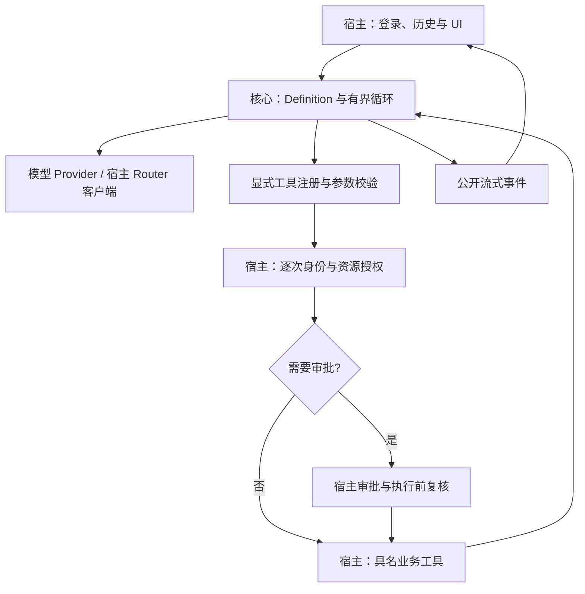

# RFC 001：可嵌入企业应用的 Agent 核心

状态：最小核心与虚构示例已有首版实现，宿主集成仍属设计。修订日期：2026-10-12。实际接口与运行方式见 [接入说明](INTEGRATION.md)；下文 Go 草案保留设计语义，类型名称以源码为准。

本轮收敛：核心只保留模型、工具、有界循环、权限/审批与事件。会话存储、持久任务和多 worker 属于宿主需求，不作为运行核心的前置条件。[评审 001](REVIEW-001-OPERATION-CAPABILITY.md) 的采纳说明记录了受控操作边界。

## 1. 定位与范围

在 GitHub 维护通用源码；宿主引入固定版本，在自己的进程中实例化助手。最简单集成是传入可信身份、历史消息、Provider、工具及权限回调，然后执行一次请求并消费事件。

核心交付五部分：模型协议与流式调用、受约束的工具注册、有界执行循环、逐次授权及可选审批、公开事件。不实现独立 Agent 平台、Goal、Workflow、命令执行、动态插件、数据库、队列或调度器。

工具由宿主明确注册，默认为无工具；未知名称拒绝。模型只能提出工具名称与业务参数，不能指定身份、工具集合、连接、系统提示或预算。工具可以读取，也可以是有明确资源范围的单一业务操作；不提供通用执行入口。

首个宿主先接入业务查询和运维只读诊断，不因公共协议支持操作就开放生产写权限。实际业务字段、来源、规则、身份和配置留在宿主仓库。

## 2. 最小嵌入架构



授权通过后，普通读取直接执行；需要审批的调用取得批准后复核权限与目标状态再执行。图中组件是职责和接口，不要求新服务、RPC 或新增 Pod。

首版布局：

```text
core/model/        消息、Provider 和模型流事件
core/tool/         定义、调用、结果与具名工具注册
core/runner/       Definition、预算、取消、授权/审批执行链
core/event/        公开回复与进度事件
providers/openai/  可选固定配置的兼容 HTTP provider
examples/embedded/ 内存虚构工具、宿主历史与审批示例
NOTICE.md          来源与改造映射
```

`core/` 只依赖 Go 标准库和内部协议，不反向依赖 provider、数据库、Redis、Web 框架或完整 SDK。现有 Router 固定 HTTP 调用直接适配 Provider，不为模型请求引入 Eino。兼容 provider 不是强制依赖；模型 endpoint 与凭据来自可信宿主配置，不来自模型参数。

## 3. 执行入口与助手定义

Definition 由宿主创建，包含 ID/版本、提示模板、模型策略、工具名称/版本集合、Chat/Agent 预算及输出规则。业务助手与运维助手使用不同定义和工具集合；配置不替代权限校验。

执行请求包含宿主构造的 Principal、执行标识、模式、历史消息与当前问题。历史消息须按当前账户、助手和数据范围筛选。每个执行拥有独立可变历史；共享不可变定义或 Provider 连接，不共享用户上下文。

有工具的执行必须提供 Authorizer 和已注册工具；缺失或检查失败时拒绝调用。纯文本 Chat 可不注册工具。EventHandler 可省略以收集最终结果；ApprovalGate 仅在需要人工确认时使用。核心无必需 SessionStore、RunStore 或持久 EventSink。

宿主负责登录、助手资格、历史/结果读取权限。核心使用可信 Principal 逐次调用 Authorizer；身份不来自用户正文、模型或工具输出。取消用 `context.Context`，审批等待也必须可以取消和超时。

## 4. 工具合同草案

以下草案示意权限、操作标识和结果的边界。实际可导入类型为 tool.Spec、tool.Call、tool.Result、tool.ExecutionContext 等，详见 [工具源码](../core/tool/tool.go) 和 [接入说明](INTEGRATION.md)：

```go
type Principal struct {
    TenantID  string
    SubjectID string
}

type ExecutionContext struct {
    Principal   Principal
    RunID       string
    CallID      string
    OperationID string // 写操作的稳定标识由宿主提供，不来自模型
}

type ToolSpec struct {
    Name             string
    Version          string
    Effect           string // 必填且限于 read / write
    InputSchema      json.RawMessage
    RequiresApproval bool
    Timeout          time.Duration
    MaxResultBytes   int
}

type ToolCall struct {
    Name      string
    Version   string
    Arguments json.RawMessage
}

type ToolResult struct {
    Status     string // available / missing / denied / invalid / unavailable;
                      // applied / conflict / partial / unknown
    EvidenceID string
    Summary    string // 可进入模型的范围过滤与脱敏摘要
}

type Authorizer interface {
    CheckTool(context.Context, ExecutionContext, ToolCall) error
}

type ToolExecutor interface {
    Execute(context.Context, ExecutionContext, ToolCall) (ToolResult, error)
}
```

ToolSpec 是可信注册元数据，Effect 和审批规则不能由模型覆盖；错误或未声明的 Effect 拒绝注册。声明 read 不证明实现或凭据真的只读。输入 schema 之外仍须在宿主核对日期、资源归属、分页、范围与目标状态。用户过滤条件与实际授权取交集。

读工具只注入必要查询接口；写工具只注入对应单一操作接口。不要传入全应用 service container、管理连接或凭据集合。模型不能传入任意 SQL、URL、bucket、连接、命令、subject 或 tenant；资源 ID 由业务代码解析并核对范围。

工具是构建时受审查的 Go 回调，不允许模型上传或自动加载实现。结果中的错误、部分完成和未知状态不得被模型描述成确定成功。证据 ID 由宿主登记；未接入、缺失、拒绝、陈旧快照与不可达应分别表达。

## 5. 固定执行链与审批

每次调用依次经过：

```text
注册/版本与 schema 校验
  → 预算、取消与宿主执行资格检查
  → 当前身份、参数和资源授权
  → 如需审批：构造具体操作提案并取得有效批准
  → 审批后复核授权、预算、执行资格及目标状态
  → 执行具名工具
  → 范围过滤与脱敏，登记证据/操作结果
  → 模型摘要与公开事件
```

权限检查与人工审批是两个步骤。普通授权读取不需要弹出审批；高影响操作按宿主策略确认。审批不能授予原本没有的权限，也不能扩大工具集合。

审批接口由宿主提供：可以等待 UI 返回，也可以返回 pending，让本次执行以 approval.required 结束。没有审批通道也按 pending 处理，绝不执行。核心不内置审批数据库、工作流或长期挂起任务；继续执行由宿主重新发起并校验批准，不盲目回放整个历史循环。

操作提案先确定工具/版本、规范化参数、具体资源、预计影响和必要目标版本。批准需绑定账户、操作标识、提案指纹、有效期与消费状态，不能只用一个“已同意”布尔值。模型和工具输出不能伪造批准。参数、资源或关键目标状态变化须重新确认；批准、业务去重和审计记录由宿主保存。

公开审批事件只展示允许用户看到的提案摘要和关联 ID；它本身不是可重用的执行凭证。批准消费与业务执行之间的故障需结合 §6 的操作标识和结果查询处理，不能靠一次性批准掩盖重复副作用。

## 6. 受控操作的最小要求

公共核心允许 `job.retry(job_id)` 等具名操作；启用前由宿主证明真实权限、影响范围与业务语义。读和写共用执行链，但写操作需要额外的去重、结果确认与审计，不能认为风险等同读取。

- **限定影响**：工具实现限定可操作的对象与数量；宿主预算另限制写调用次数。首个操作示例一次只涉及一个虚构任务，不开放任意批量或配置写入。每个写工具都必须提供只读 Prepare 描述具体资源、目标版本与影响；免人工审批不等于跳过该核对。
- **不自动重放**：核心默认不自动重试写调用，恢复也不能自动重放。稳定 OperationID 对应同一次用户意图；不同意图必须使用不同 ID，不能仅按相同参数永久去重。
- **真实幂等**：若业务接口提供持久去重/结果查询，宿主可显式用同一 OperationID 核对并安全继续。一次执行只生效一次须由业务系统验证，`Idempotent=true`、进程内锁或 Run 去重不能证明这一点。
- **结果不确定**：请求超时、断线或取消不等于未执行。无法确认时返回 unknown 并停止自动操作，查询业务结果或交给人工；partial、conflict 分别报告，不能压成 applied。取消不回滚已经发生的修改。
- **审计和验证**：业务接口记录操作标识、账户、工具版本、实际影响资源、结果及必要变更摘要。原始审计与给模型的摘要分离。执行结果能查询时优先核对；无法核对则保留未核验状态。

首版不实现通用补偿、撤销编排或 dry-run 引擎。宿主有预览/撤销能力时可显式注册具名工具，每次仍需授权和必要审批；预览不是执行授权，补偿不保证回滚。

## 7. Chat / Agent、预算与事件

Chat 聚焦当前问题，Agent 允许更主动地组合多步工具调用。两者共用执行器和权限链，不代表只读/可写等级，不要求后台化，也不使用 Goal 评估器无限继续。

宿主为两种模式设置有限的总时长、模型轮数、工具次数、输出大小、重试次数与并发；写工具另有调用上限。不存在无限预算或由模型扩大预算的路径。默认串行；并行仅用于宿主声明安全的读取，写操作不并行。具体数值由宿主结合请求时限和实测负载确定。

循环检测、模型错误、预算耗尽和取消都明确终止；保留已知结果并标记未完成。token 与金额额度依赖可信用量信息，未知价格/用量时不宣称精确金额硬上限。超时通过 context 传播；工具实现及底层客户端须支持期限和取消，核心不能强制杀死任意 Go 回调。

公开事件包括 delta、tool.start/progress/end、approval.required、done、error。事件含执行/轮/代次标识，公开字段白名单不得包含模型私有推理、原始工具结果、凭据或上游错误正文。进度描述具体查询与已知状态，不展示思维链。

文本 delta 是临时预览；只有模型流完整结束且最终结果校验通过，才能产生核心完成结果。宿主如需持久化，保存成功后再向 UI 发布其最终成功状态。待批准使用 approval.required 终止或暂停当前展示，不作为已完成回答。工具变更已 applied 不保证最终回答或持久化成功，恢复应查询操作记录而非重做变更。

## 8. 会话、HTTP 与持久任务归宿主

宿主负责账户历史、会话列表、切换/继续、刷新恢复、保存与到期策略，向核心提供必要上下文。助手和数据范围不同的历史隔离；权限变窄时不能带入旧的受限证据。默认同一会话一个活跃执行，但并发控制在宿主落实。

既有 POST + SSE 可直接消费核心事件；不要求 /v1 API、统一 202、新 UI 或独立服务。宿主通过执行/代次标识忽略迟到事件；用户切换会话不会把旧流写进新会话。取消对话不等于取消被诊断的生产任务。

简单即时问答不需要任务队列或检查点。需要长任务、断线后继续或多 worker 时，宿主自行提供持久执行状态与调度，并在每次工具调用前通过可信授权适配器同时核验执行资格；核心不引入 RunStore、fence 或 outbox 协议。

这类宿主需处理原子接收、分发丢失/重复、幂等键、领取/租约、旧 worker 提交和恢复预算。PG/Redis 是可选实现，不属于公共核心交付前提。租约或提交 CAS 不保证外部副作用 exactly-once；恢复时读调用也可能重复，写调用遵守 §6。不同 Definition/工具版本不兼容时停止恢复。

这些保障按宿主真正启用的功能验收：多 Pod 提供同步问答不自动需要后台 Agent 队列，承诺后台任务接管时才需对应恢复合同。

## 9. 源码引入与公开示例

从 EasyAgent 固定提交提取消息、流、Provider 与必要工具协议，保留 LICENSE/NOTICE。不迁入个人 AgentSession 的工作区、Goal、Workflow、JSONL、全部 hooks 或编码工具。来源清单记录 repo/tag/SHA、文件映射、import 调整和本地改造。

最小 demo 是一个 Go 程序：data-analyst 与 artifact-diagnostics 分别注册虚构查询工具，历史由调用方传入，不依赖数据库、Redis 或独立服务。诊断工具包括 schedule.inspect、job.runs、artifacts.inspect、publication.status。

另提供显式启用的虚构 `job.retry` 场景：诊断 → 展示提案 → 宿主批准 → 具名操作 → 结果查询。验证拒绝、pending、过期/变更提案、重复操作标识、partial 与 unknown；不接触真实任务，不把操作注册到默认只读助手。

真实 SQL、角色映射、对象路径、统计口径、内部日志与生产信息留在宿主。通用接口存在不表示来源已接入。宿主升级先比较来源差异，再执行授权、会话、取消、SSE 和工具结果回归，不能覆盖私有边界代码。

## 10. 精简交付路线

| 阶段 | 交付 | 完成条件 |
| --- | --- | --- |
| v0.1 | 五部分最小核心、可选 HTTP provider、无外部设施的虚构嵌入示例 | 源码可复制构建；授权/预算/取消/流式与审批拒绝通过；写操作默认不重试 |
| 宿主接入 | 既有 Router、业务查询/诊断工具、历史与 UI 适配 | 旧接口、账户隔离、会话切换/继续和查询结果回归通过 |
| 按实际需求扩展 | 具名业务操作，或宿主长任务/多 worker 支持 | 仅启用的能力通过对应业务幂等、审批、审计或恢复验收 |

不把通用 PG/Redis 适配器、Workflow、后台任务平台或全部企业治理字段排成必经版本。首版采用受控操作最小合同，不预建通用变更管理平台。

## 11. 同进程边界与依据

嵌入核心限制模型入口，不提供 OS 隔离。宿主进程被完全控制后，攻击者可能访问其已有凭据；宿主继续负责代码、依赖、容器及后端权限安全，不以本项目为由默认拆服务。

- [EasyAgent 架构](https://github.com/hwj123hwj/easyagent/blob/d90804fbe5cf488e6ace810cff925f7cc8b8c6d9/docs/ARCHITECTURE.md)：源码参考边界。
- [OWASP Excessive Agency](https://genai.owasp.org/llmrisk/llm062025-excessive-agency/)：最小工具与权限、下游授权和高影响操作审批。
